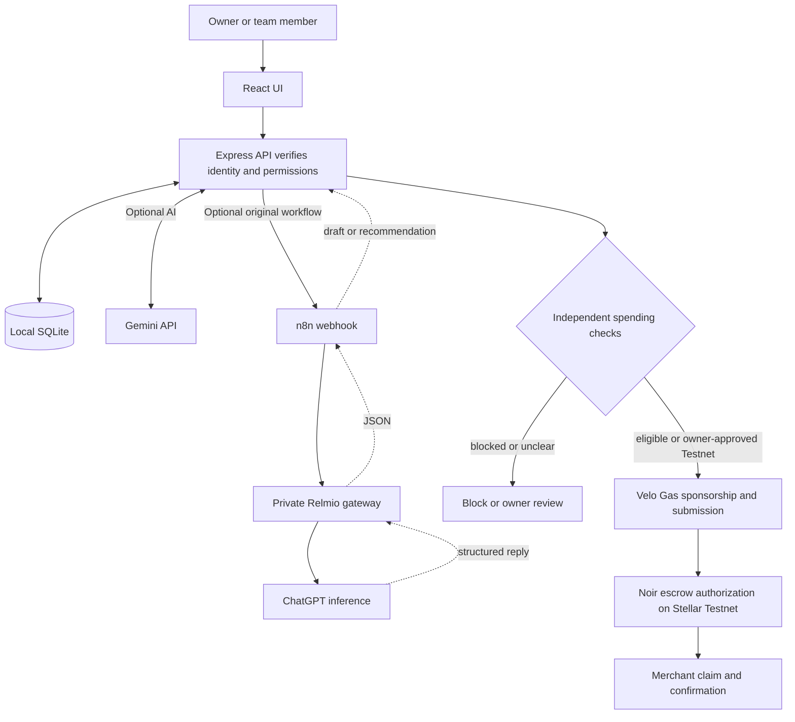

# Allowance

An owner sets a budget, assigns work and defines which expenses are eligible. A team member signs in with their email and an owner-issued code, describes a purchase and submits it for review. AI helps with the explanation and draft. The backend enforces identity, assignments, suppliers and budgets and records the decision.

**Current demo** supports owner and member accounts, rules, requests, assistant decisions and Stellar Testnet payments. A complete Velo-sponsored authorization and merchant claim still needs an end-to-end test.

## Run on your laptop

Ask the repository owner for access to this private repo. Install [Git](https://git-scm.com/downloads) and [Node.js 24.22.1](https://nodejs.org/en/download), the tested Node version. Run these commands in a terminal:

```powershell
git clone https://github.com/Enerbonn/Allowance.git
cd Allowance
npm ci
npm run build
npm start
```

Open [Allowance on port 4310](http://127.0.0.1:4310/). On Windows, after the first build you can double-click [START.cmd](START.cmd) instead of running `npm start`. Use it again after a reboot. Run `npm run dev` while editing source. To check your installation, run `npm test`.

### Choose how to try it

| I want to… | What I need |
| --- | --- |
| Try the owner and member workflow | **Start here.** Run the commands above, then follow the demo below. No API key, Docker, or wallet needed. |
| Chat with the assistant | Create a Gemini API key, add it to `.env.local`, restart and test the connection. [Gemini quick setup](docs/AI-SETUP.md#option-1-use-gemini-directly) |
| Reproduce the original ChatGPT workflow | Use your own n8n instance and Relmio connection. [Relmio and n8n setup](docs/AI-SETUP.md#option-2-use-chatgpt-through-relmio-and-n8n) |
| Connect a wallet and try Stellar Testnet | Create and fund a test wallet, connect it in Allowance and link a registered Velo project when ready to pay. [Wallet and Testnet tutorial](docs/HACKATHON.md#wallet-and-testnet-tutorial-on-windows) |

### Try both roles

1. Choose **Business owner → Sign up**. At **Create your owner account**, enter your name, email, and a password of at least eight characters. An existing owner without an email can add it using their current code. Each new owner gets a separate workspace with no sample records.
2. In **Team**, select **Add member** and enter the email they gave you. Use **Draft responsibilities** on that profile if you want help drafting responsibilities and spending limits. Review suggestions before applying them.
3. In **Projects**, create a project with a budget, then assign a task to the member. In **Spending policy**, add an approved supplier and review the spending limits and evidence rules.
4. Back in **Team**, select **Issue code** for the member and share the member’s sign-in email and the private code shown once. Open your account menu and sign out, then choose **Team member** and sign in with their email and code.
5. Complete the Testnet payment setup and enable **Allow automatic Testnet payments**. Submit a request for the assigned task and approved supplier. Clear eligible requests can proceed within the automatic limit, and uncertain requests go to the owner. Open the Testnet receipt after the merchant claim is confirmed.

For a prefilled demo, stop the current server and start a separate database from PowerShell. These settings apply to that terminal:

```powershell
$env:ALLOWANCE_DB = '.local/allowance-sample.sqlite'
$env:ALLOWANCE_SAMPLE_DATA = '1'
npm start
```

Close that terminal when you finish the sample demo. Start from a new terminal or use `START.cmd` to return to the default workspace.

Member budgets are lifetime totals across projects. Zero blocks spending while keeping chat access. Clearing the member limit returns to the project limits. Without AI, the request form still works and the owner can review eligible requests manually.

## Owner setup

Open **Overview** to track workspace setup and Testnet setup separately. Use the action on each step to enter the details yourself, or select **Set up with assistant** to work through missing steps in conversation. The assistant drafts records for you to review and apply. Enter a new member’s email on the review card. Issue their code from Team after the profile is saved.

In **Connections**, select the owner wallet and initialize the managed agent. Register the device, review the agent’s per-transaction cap and expiry, then sign. You can choose a specific date, no expiry, or no contract cap. Workspace spending limits still apply. Fund escrow and set up Velo before testing a payment. [Testnet walkthrough](docs/HACKATHON.md)

## Deploy the demo

Use Vercel for the frontend and Render for the API and its persistent disk. Follow the [deployment guide](docs/DEPLOY.md).

## Tech stack and code map

| Layer | Stack | Entry point |
| --- | --- | --- |
| Browser | React, TypeScript/TSX, CSS, Vite | [src/App.tsx](src/App.tsx), [src/Workspace.tsx](src/Workspace.tsx) |
| Server | Node.js, Express, TypeScript, Zod | [server/index.ts](server/index.ts), [server/app.ts](server/app.ts) |
| Access and AI context | scrypt, server sessions, Markdown instructions | [server/workspace.ts](server/workspace.ts), [server/agent-instructions.md](server/agent-instructions.md) |
| Persistence and checks | SQLite, SQL, integer XLM amounts | [server/store.ts](server/store.ts), [server/domain.ts](server/domain.ts) |
| AI | Gemini API directly, or ChatGPT through n8n and Relmio | [Importable n8n workflow](n8n/allowance-review.json), [AI setup guide](docs/AI-SETUP.md) |
| Testnet | Stellar Wallets Kit, Stellar SDK, Noir Agent SDK, Velo SDK | [src/Testnet.tsx](src/Testnet.tsx), [server/testnet.ts](server/testnet.ts) |



### Monitor spending and make changes

- **Overview** shows paid and pending Testnet purchases. It shows the latest checked Noir escrow balance and agent expiry. Open a request to see what the member needed, the decision, and its receipt.
- **Team** can add members, update profiles and spending limits, issue access codes, and remove or restore access. Removing access immediately ends their sessions and revokes their code. Prior requests remain in the ledger. Issue a new code after restoring access. Members sign in with their own email and issued code.
- **Connections** remembers multiple wallets with separate Testnet settings. Select one at a time and reconnect the matching wallet to sign. The owner can deposit to Noir escrow or withdraw to the registered owner wallet. A pending payment must be reconciled before switching, disconnecting, or withdrawing. Disconnecting keeps the setup and ledger records.

### How a conversation edits one field

Ask the assistant to “Set Maya’s weekly cap to 500 XLM.” The backend sends the authenticated role, permitted records, and exact member IDs to Gemini or the n8n webhook. The model returns a reply plus a proposal such as:

```json
{
  "type": "profile",
  "targetId": "maya",
  "fields": { "weeklyBudget": "500" },
  "summary": "Set Maya’s weekly cap to 500 XLM."
}
```

The preview shows the member and the field. When the owner applies it, the server verifies their session, checks the profile version, validates the amount, and writes only the permitted field. A normal manual form writes the same field. The weekly cap resets Mondays at midnight in Manila and counts paid and reserved purchases. It applies in addition to project, all-time, per-request and on-chain limits. Clearing the field removes the separate weekly cap. Setting it to zero blocks spending. Changing a Noir authorization or moving escrow funds requires the wallet signature steps.

The Markdown file contains assistant instructions. SQLite stores chats, reviewed notes, requests and decisions. Before each call the backend retrieves recent messages and keyword matches from the person's permitted records and calculates exact totals separately. Owners can ask about the workspace ledger. Members can only retrieve their own requests and chats, plus shared owner-reviewed notes. The assistant can miss a paraphrased older reference, so use a request title or ID for a precise lookup. No embedding service is required. Evidence files are available for human review; the assistant sees whether evidence was supplied.

Before spending, the backend checks membership, assignment, supplier, category, evidence and available budgets. Clear assistant declines close the request with a reason. Uncertain assessments, missing information, or purchases above the automatic limit go to the owner. Enable **Allow automatic Testnet payments** in Spending policy after configuring the Testnet wallet, Noir agent, escrow and Velo Gas. Owners enable Testnet automation explicitly after reviewing agent authority and spending caps. Existing simulation receipts remain historical records. It uses **integer stroops** for exact amounts, **SQLite transactions** for competing approvals, and **idempotency keys** to prevent duplicate requests. Uncertain Testnet outcomes keep a reservation for reconciliation.

- **Connections → steps 2–4** includes setup instructions. Noir's device registry links the setup to the owner wallet, the agent registry records spending authority, and payment escrow holds and pays out test XLM. The sponsored purchase calls payment escrow, so that is the contract to allow in Velo Gas Station.
- **Spending policy → Supplier directory** accepts fictional demo suppliers and owner-approved alternate quote websites. The hostname is checked against the selected supplier's record without visiting the website. For a test purchase, link that supplier to the demo recipient in Connections.
- **Requests** distinguishes an approval from a completed payment. With Allowance open, it checks pending Velo handoffs by their existing tracking ID. If Velo still says submitted, Allowance can verify the same authorization directly on Stellar. It records payment only when Stellar confirms the exact Noir claim to the demo recipient. Uncertain handoffs keep their budget reservation; a confirmed failed authorization releases it.

## AI credentials and APIs

An API lets the backend send a request to an AI service and receive a structured response. Gemini uses your own Google AI Studio API key. The original route sends a webhook to n8n, which calls Relmio’s local API using a bearer from the Relmio setup. Relmio connects to your authorized ChatGPT account. [AI setup guide](docs/AI-SETUP.md) · [Relmio on GitHub](https://github.com/Demonbane18/relmio)

The project uses these configuration names. Each machine supplies its own values.

| Name | Purpose |
| --- | --- |
| `GEMINI_API_KEY` | Your Google AI Studio key. Setting it selects Gemini at startup |
| `GEMINI_MODEL` | Optional model override. Defaults to `gemini-3.1-flash-lite` |
| `N8N_REVIEW_URL` | n8n production webhook URL. Defaults to `http://127.0.0.1:5679/webhook/allowance-review-v1` |
| `ALLOWANCE_N8N_TOKEN` | Shared header token for the app-to-n8n webhook. The app can also read its local token file |
| `RELMIO_BEARER` | Documentation label for your own bearer entered into the n8n OpenAI credential |
| `VELO_GAS_API_KEY` | Documentation label for the Testnet Gas key entered through `Save-GasKey.ps1` on Windows |

The app saves local records in `.local/allowance.sqlite`. The Git ignore rules cover `.local/`, private configuration, encrypted keys, build output and installed packages. Each clone starts with its own database. Keep the server bound to localhost for this demo.

## Hackathon fit

The organizer’s supplied brief asks for an agentic payment built with Velo and interacting with the current Noir Testnet contracts. Allowance uses owner-defined authority, agent-assisted requests and an independently enforced payment policy. See [the rule-by-rule mapping, contract IDs and remaining Testnet proof](docs/HACKATHON.md).
