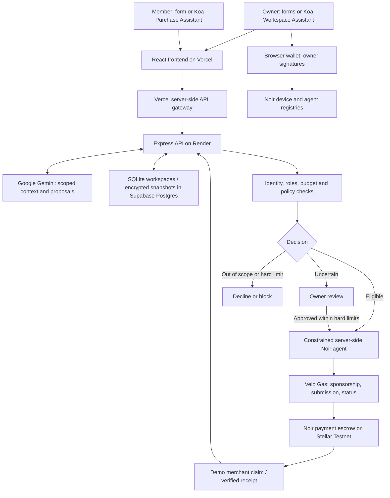
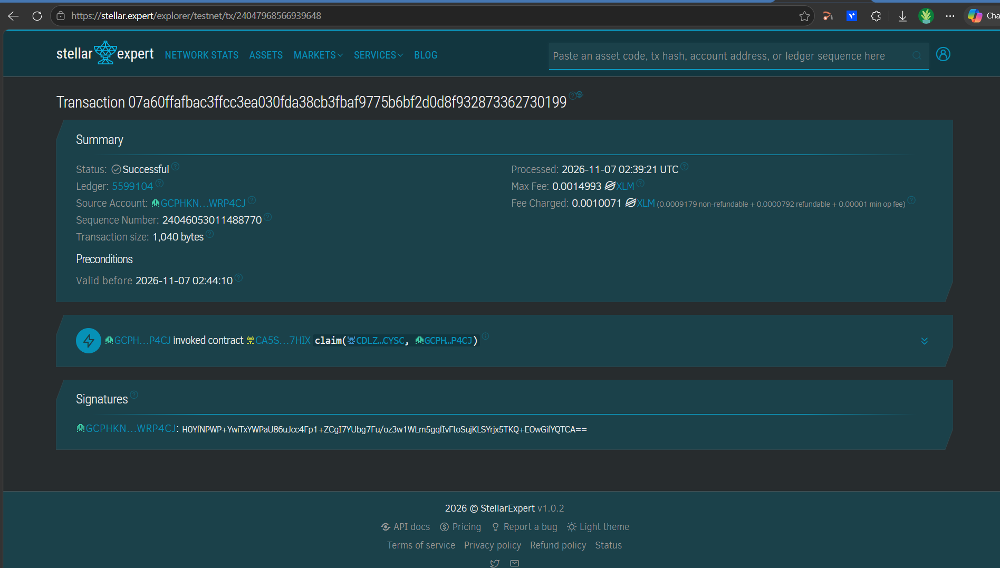

# KoaSpend

An automated spending desk for managers and their teams: Koa helps set up budgets, prepares member requests, and approves eligible Stellar Testnet payments within the owner's rules.

**Live website:** https://koaspend-kappa.vercel.app

**Demo video (2 min):** [Watch KoaSpend demo](https://drive.google.com/file/d/1tlFxvj1F-1QsxQIXswPSQs8vGYS9QWML/view?usp=sharing)

**Pitch deck:** [View public pitch deck](https://drive.google.com/file/d/1SmUkzC-brMcHlsmGQ_sHOaLdE9Xr7GwQ/view?usp=sharing)

**Team:** BackSlashN — Leon Angelo Cañelas (@angelord1007), Ace Lance Benegas (@lanceace0682), Irvin John Parulan (@enerbonn), Eduardo Constantino III (@imnotward_.)

> **Contract update:** New payments use the Noir deployment listed in the Nov 7 handbook. Existing owners must register/authorize and fund the updated deployment, and allow its escrow in Velo Gas Station. Earlier receipts remain historical proof; old escrow balances do not move automatically. [Migration steps](docs/HACKATHON.md#existing-wallets-after-the-update).

## Problem

Managers cannot be available to approve every small work purchase. Team members lose time waiting for resources, while owners still need control over budgets, responsibilities and proof of payment. Giving an assistant unrestricted wallet access would remove that control.

## Solution

Owners define members, roles, assigned work, project budgets, spending categories and limits. They can enter everything manually or ask **Koa Workspace Assistant** to draft profiles and settings, review the proposed changes, then apply them.

Members can submit a form or ask **Koa Purchase Assistant** to prepare an editable request preview. Clear eligible purchases can proceed automatically when the owner enables automation; uncertain suppliers or incomplete details go to owner review, while clearly unrelated purchases are declined. Server-side identity, budget and payment checks remain mandatory.

**Explore the shared Testnet demo:** choose **Business owner → Sign in**, email `owner1@email.com`, password `password`. This is an intentionally public demo login, not a deployment secret. Please do not overwrite its rules, reset access, or add personal information. To experiment freely, choose **Sign up** and create your own isolated owner workspace. Members have sign-in only; their owner creates their profile and issues an access code. A fresh local clone does not contain the hosted demo account.

## How the agentic payment works

1. The owner connects a funded Stellar Testnet wallet, registers its Noir device association, authorizes a constrained agent and deposits test XLM into escrow.
2. The owner configures Velo Gas sponsorship and the workspace's automatic spending policy.
3. A verified member explains what they need and how it supports an assigned task. Koa prepares a draft; the member previews and submits it.
4. Gemini assesses relevance and uncertainty. The backend independently enforces roles, assignment, categories, evidence rules, budgets and the automatic limit. A recognized name alone does not prove a website or payment destination is safe.
5. Eligible requests reserve budget and the backend agent signs a Noir payment authorization for the request amount and configured Testnet recipient. Velo sponsors the fee and submits the transaction. Uncertain outcomes retain their reservation for reconciliation.
6. The managed demo merchant claims the authorization. Only a confirmed matching claim marks the request paid and updates the ledger/dashboard. Owner approval alone is not proof of payment.

All new payments use **Stellar Testnet**. Fictional shops can be used in the demo, but funds go to the configured Testnet demo recipient, not an actual subscription provider. This prototype does not purchase fiat-only subscriptions or convert cryptocurrency to cash.

## Architecture



The server stores accounts, hashed credentials, sessions, chats, reviewed context, rules and requests. Markdown files hold system instructions; conversation memory is scoped database retrieval, not a public Markdown dump. Supabase persistence is encrypted file snapshots in a private schema, **not** a normalized Supabase Auth/users implementation. Run one backend instance. Details: [deployment and persistence](docs/DEPLOY.md).

## Noir integration

- SDK: **`@noirx402/agent-sdk` 0.3.0** (locked in `package-lock.json`).
- Calls all three contracts: `device_registry` for ownership, `agent_registry` for authority, and `payment_escrow` for funding, authorization and claim.
- [Configured contract IDs](server/testnet.ts#L15), [Noir client](server/testnet.ts#L109), [owner operation preparation](server/testnet.ts#L333), [merchant claim and receipt verification](server/testnet.ts#L213), [agent payment preparation](server/testnet.ts#L410).
- Uses SDK `prepare` with `registerDevice`, `registerAgent`, `fundEscrow`, `defundEscrow`, `authorize` and `claim` operations; `submit` and the SDK's RPC client confirm results. See [full implementation](server/testnet.ts) and [adapter preflight/checkPayment](server/testnet-adapter.ts).
- Current contract IDs match the installed SDK defaults and the Nov 7 handbook. Earlier pending operations retain their original deployment for reconciliation. [Deployment and migration details](docs/HACKATHON.md).

## Velo integration

- SDK: **`@carts1024/velo-sdk` 0.1.0-alpha.4**.
- Velo Gas covers network fees, submits signed Testnet authorizations and provides tracking/recovery status. [Sponsorship and submission](server/testnet.ts#L412), [status reconciliation](server/testnet.ts#L258), [adapter](server/testnet-adapter.ts#L41).
- Owners save their project URL/ID and scoped Testnet Gas key through Connections. Secrets remain on the backend.
- This integration uses Gas sponsorship/status. It does **not** claim to implement Velo checkout sessions or signed checkout webhooks.

## Testnet proof

**Current handbook deployment:** [Confirmed 1 XLM recipient claim](https://stellar.expert/explorer/testnet/tx/3e1fd95eda8900b870097abc34cd2ccd74baca853d5a7ce6a7e03bd218daf68f).

Hash: `3e1fd95eda8900b870097abc34cd2ccd74baca853d5a7ce6a7e03bd218daf68f`.

A fresh SDK-only Testnet check registered a device, authorized an agent, deposited 5 XLM, authorized/claimed 1 XLM and withdrew the remaining 4 XLM on the current contracts. The app's receipt verifier checked the exact escrow, recipient and amount. [Public operation hashes and verification scope](docs/noir-migration-proof.json). This probe did not exercise Gemini, browser signing or Velo sponsorship; repeat the complete application flow after updating your Velo allowlist.

**Historical application demo:** [Original Velo/Noir merchant claim](https://stellar.expert/explorer/testnet/tx/07a60ffafbac3ffcc3ea030fda38cb3fbaf9775b6bf2d0d8f932873362730199). The video shows the earlier deployment's request assessment, authorization and saved receipt. Horizon confirmed that historical transaction at ledger `5599104`. Earlier proof is retained as history, not relabeled as a payment on the updated contracts. Testnet may reset.

## Repo structure

```text
Allowance/                 # Repository name retained; product is KoaSpend
├── src/                   # @koaspend/web npm workspace: React UI and assets
├── server/                # @koaspend/server workspace: API, agent, rules, persistence, tests
├── api/                   # Vercel gateway; browser never receives server tokens
├── docs/                  # AI, hosting, wallet tutorial, screenshots
├── .env.example           # Empty configuration reference; no deployment secrets
├── package.json           # Workspace root; one npm ci installs everything
├── package-lock.json      # Reproducible dependency versions
├── Dockerfile             # Render backend image
├── render.yaml            # Optional PAID disk deployment; see free Supabase path
└── vercel.json            # Frontend build and API routing
```

Workspace folders keep the existing working source layout. Shared business types currently live in `server/domain.ts`; the code has not been moved just to match an example folder tree.

## Run it locally

1. Install Git and **Node.js 24.22.1** (Node 24; use `node --version`). Gemini needs your own API key. Wallet + test XLM are needed only for payment testing, not initial UI/account setup.
2. Clone and install from the root:

   ```sh
   git clone https://github.com/Enerbonn/Allowance.git
   cd Allowance
   npm ci
   ```

3. Copy `.env.example` to **`.env.local`**. PowerShell: `Copy-Item .env.example .env.local`; macOS/Linux: `cp .env.example .env.local`. Set `GEMINI_API_KEY`. Leave hosted variables empty for localhost. The server explicitly loads `.env.local`. On Linux/macOS, set `ALLOWANCE_STORAGE_KEY` before using protected Testnet credentials; generate it with `node -e "console.log(require('node:crypto').randomBytes(32).toString('base64'))"` and store it privately.
4. Build and start:

   ```sh
   npm run build
   npm start
   ```

5. Open http://127.0.0.1:4310. Choose **Business owner → Sign up**. Enter name, email and password. Review/save the suggested policy, add a member and issue their code, create a project and assign a task. Fresh clones have no hosted accounts or wallet keys.
6. Open **Connections → Test connection** for Gemini. Then follow the [wallet / Noir / Velo tutorial](docs/HACKATHON.md#wallet-and-testnet-tutorial-on-windows). Do not use real funds. Use the current escrow address in your Velo Gas allowlist.
7. Sign out and choose **Team member**. Use their saved email and owner-issued code. Ask Koa for a draft or use **New request**, preview, submit, and inspect the decision and confirmed receipt.

Development: `npm run dev`. Verification: `npm test` and `npm run build`. The optional Postgres integration test requires its documented test database and is skipped without it. Automated tests do not replace a live wallet-signing/payment test. [AI setup](docs/AI-SETUP.md) · [Online setup in order](docs/DEPLOY.md).

## Environment variables

Copy the names from [.env.example](.env.example); fill values only in local private files or host dashboards. Existing `ALLOWANCE_` names remain for deployment compatibility.

| Name | What it is | Where to get it |
| --- | --- | --- |
| `GEMINI_API_KEY` | Render/local only; Koa model access | [Google AI Studio](https://aistudio.google.com/api-keys) |
| `GEMINI_MODEL` | Optional JSON-capable model override | Your Google project's supported models; code default is `gemini-3.1-flash-lite` |
| `ALLOWANCE_OWNER_SETUP_TOKEN` | Render only; legacy setup API token, not signup password | Generate a distinct random token (32 bytes hex) |
| `ALLOWANCE_PROXY_TOKEN` | Shared server-only gateway token, identical on Render and Vercel | Generate 32 random bytes as hex |
| `ALLOWANCE_PUBLIC_ORIGIN` | Exact production Vercel HTTPS origin on both hosts | Vercel Domains; no trailing slash |
| `ALLOWANCE_STORAGE_KEY` | Stable 32-byte base64 encryption key; Render and non-Windows local Testnet | Generate securely; keep a private backup |
| `SUPABASE_DATABASE_URL` | Render only; private Postgres connection URI | Supabase Connect → Session pooler; replace/encode database password |
| `SUPABASE_CA_CERT` | Render only; whole trusted PEM certificate | Supabase Database Settings → SSL configuration |
| `ALLOWANCE_BACKEND_URL` | Vercel only; exact Render HTTPS origin | Render service dashboard |
| `ALLOWANCE_DATA_DIR` | Backend writable data directory | Dockerfile sets `/data`; local default `.local/` |
| `PORT` | Hosted listen port | Render supplies automatically; local app uses 4310 |

Do not put database passwords, Gemini/Gas keys, wallet secret keys, or real user credentials into source. `.env.local`, `.local/`, databases and protected key files are ignored. Velo Gas credentials are entered through Connections, not required in the root environment file. Do not rotate the storage encryption key on an existing database without a migration: existing data would become unreadable.

## Screenshots



The [two-minute video](https://drive.google.com/file/d/1tlFxvj1F-1QsxQIXswPSQs8vGYS9QWML/view?usp=sharing) shows owner setup, member requests, automated decisions and payment evidence. It is hosted separately so Git clones stay small.

## What's next

- Repeat the complete browser/Gemini/Velo-sponsored purchase flow on the updated deployment after owner setup.
- Production payment-provider/off-ramp integration, normalized database scaling, email verification/recovery and stronger production account controls.
- This is a Testnet hackathon prototype. Render Free may cold-start and Supabase/Gemini free plans have quotas; the laptop is not required for the hosted Gemini path.

## Credits

Built by **BackSlashN**. Frontend design contribution: [KoaSpend UI repository](https://github.com/Kharl-png/KoaSpend). AI-assisted development/editing with OpenAI Codex; demo editing with Remotion and FFmpeg.

Libraries and infrastructure: [Noir and its Agent SDK](https://github.com/noirx402/noir), [Velo and its SDK](https://github.com/Velo-Ecosystem-Collection/Velo), [Stellar JavaScript SDK](https://github.com/stellar/js-stellar-sdk), [Stellar Wallets Kit](https://github.com/Creit-Tech/Stellar-Wallets-Kit), Google Gemini, React, Vite, Express, Zod, Node SQLite, PostgreSQL/pg, Supabase, Render, Vercel, Lucide icons and Manrope. Dependency versions are recorded in `package-lock.json`.
