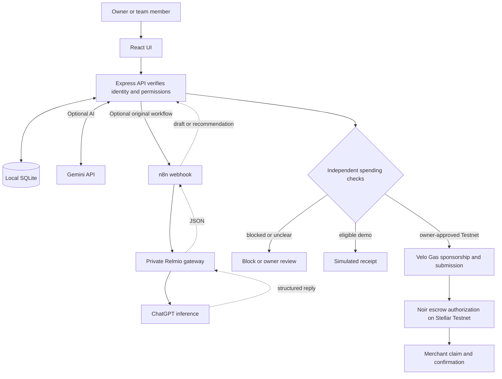

# Allowance

An owner sets a budget, assigns work and defines which expenses are eligible. A team member signs in with an owner-issued code, describes a purchase and submits it for review. AI helps with the explanation and draft. The backend enforces identity, assignments, suppliers and budgets and records the decision.

**Current demo** supports owner and member accounts, rules, requests, manual or AI-assisted review and local payment simulation. The Stellar Testnet integration has passed read-only contract checks. A complete authorization and merchant claim still needs an end-to-end test.

## Run on your laptop

Ask the repository owner for access to this private repo. Install [Git](https://git-scm.com/downloads) and [Node.js 24.22.1](https://nodejs.org/en/download), the tested Node version. Run these commands in a terminal:

```powershell
git clone https://github.com/Enerbonn/Allowance.git
cd Allowance
npm ci
npm run build
npm start
```

Open [Allowance on port 4310](http://127.0.0.1:4310/). On Windows, after the first build you can double-click [START.cmd](START.cmd) instead of running `npm start`. Use it again after a reboot. Run `npm run dev` while editing source. To check your installation, run `npm test`.

### Choose how to try it

| I want to… | What I need |
| --- | --- |
| Try the owner and member workflow | **Start here.** Run the commands above, then follow the demo below. No API key, Docker, or wallet needed. |
| Chat with the assistant | Create a Gemini API key, add it to `.env.local`, restart and test the connection. [Gemini quick setup](docs/AI-SETUP.md#option-1-use-gemini-directly) |
| Reproduce the original ChatGPT workflow | Use your own n8n instance and Relmio connection. [Relmio and n8n setup](docs/AI-SETUP.md#option-2-use-chatgpt-through-relmio-and-n8n) |
| Connect a wallet and try Stellar Testnet | Create and fund a test wallet, register a Velo project and connect it in Allowance. [Wallet and Testnet tutorial](docs/HACKATHON.md#wallet-and-testnet-tutorial-on-windows) |

### Try both roles

1. Create the owner profile and private access code. The login ID for this role is **`owner`**. The name you enter is a display name.
2. Open **Team**. Try the sample member Maya Chen, or create a new member and assign a task in **Projects**. Edit their role, responsibilities, categories and allowance. Select **Issue code** and privately copy both the member ID and the code shown once.
3. Sign out and sign in with the member credentials. Request a business purchase for an assigned task. Try a 25 XLM font license from the sample supplier Type Foundry for the Northstar brand identity. Choose **Local simulation**. A sample quote link such as `https://typefoundry.example/quote/font25` is suitable for the demo.
4. Sign in as owner, open the request and review the checks. If eligible, approve it with a decision note and inspect the simulated receipt and updated balance. Try a purchase beyond the allowance to see a policy block.

Member budgets are lifetime totals across projects. Zero blocks spending while keeping chat access. Clearing the member limit returns to the project limits. Without AI, the request form still works and the owner can review eligible requests manually.

## Tech stack and code map

| Layer | Stack | Entry point |
| --- | --- | --- |
| Browser | React, TypeScript/TSX, CSS, Vite | [src/App.tsx](src/App.tsx), [src/Workspace.tsx](src/Workspace.tsx) |
| Server | Node.js, Express, TypeScript, Zod | [server/index.ts](server/index.ts), [server/app.ts](server/app.ts) |
| Access and AI context | scrypt, server sessions, Markdown instructions | [server/workspace.ts](server/workspace.ts), [server/agent-instructions.md](server/agent-instructions.md) |
| Persistence and checks | SQLite, SQL, integer XLM amounts | [server/store.ts](server/store.ts), [server/domain.ts](server/domain.ts) |
| AI | Gemini API directly, or ChatGPT through n8n and Relmio | [Importable n8n workflow](n8n/allowance-review.json), [AI setup guide](docs/AI-SETUP.md) |
| Testnet | Freighter-compatible wallet API, Stellar SDK, Noir Agent SDK, Velo SDK | [src/Testnet.tsx](src/Testnet.tsx), [server/testnet.ts](server/testnet.ts) |



The backend selects records for the authenticated role and sends relevant history and reviewed memory notes to the workflow. Suggestions wait for a user action before changing a profile, policy or memory. The owner can ask for status updates. Members receive context for their assigned work. Purchase evidence files are available for human review. The AI sees metadata about whether evidence was supplied.

Before spending, the backend checks membership, assignment, supplier, category, evidence and available budgets. It uses **integer stroops** for exact amounts, **SQLite transactions** for competing approvals, and **idempotency keys** to prevent duplicate requests. Uncertain Testnet outcomes keep a reservation for reconciliation.

## AI credentials and APIs

An API lets the backend send a request to an AI service and receive a structured response. Gemini uses your own Google AI Studio API key. The original route sends a webhook to n8n, which calls Relmio’s local API using a bearer from the Relmio setup. Relmio connects to your authorized ChatGPT account. [AI setup guide](docs/AI-SETUP.md) · [Relmio on GitHub](https://github.com/Demonbane18/relmio)

The project uses these configuration names. Each machine supplies its own values.

| Name | Purpose |
| --- | --- |
| `GEMINI_API_KEY` | Your Google AI Studio key. Setting it selects Gemini at startup |
| `GEMINI_MODEL` | Optional model override. Defaults to `gemini-3.1-flash-lite` |
| `N8N_REVIEW_URL` | n8n production webhook URL. Defaults to `http://127.0.0.1:5679/webhook/allowance-review-v1` |
| `ALLOWANCE_N8N_TOKEN` | Shared header token for the app-to-n8n webhook. The app can also read its local token file |
| `RELMIO_BEARER` | Documentation label for your own bearer entered into the n8n OpenAI credential |
| `VELO_GAS_API_KEY` | Documentation label for the Testnet Gas key entered through `Save-GasKey.ps1` on Windows |

The app saves local records in `.local/allowance.sqlite`. The Git ignore rules cover `.local/`, private configuration, encrypted keys, build output and installed packages. Each clone starts with its own database. Keep the server bound to localhost for this demo.

## Hackathon fit

The organizer’s supplied brief asks for an agentic payment built with Velo and interacting with the current Noir Testnet contracts. Allowance uses owner-defined authority, agent-assisted requests and an independently enforced payment policy. See [the rule-by-rule mapping, contract IDs and remaining Testnet proof](docs/HACKATHON.md).
